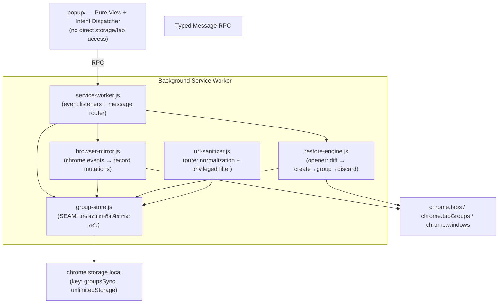

# Single Source of Truth (SOT) — SyncTab Group Sync Extension (Microsoft Edge on Ubuntu Linux)

> **Version:** 3.0.0 (Group-Only Sync — redesign)
> **Target Platform:** Microsoft Edge on Ubuntu Linux OS (Primary) & Chromium Browsers (Manifest V3)
> **Status:** Design approved ผ่าน grilling Rounds 1–3 (20 ต.ค. 2026) — implementation ยังไม่เริ่ม
> **Language:** Thai & Technical English
> **ประวัติระบบเก่า (v2.3.0 window-sync):** `docs/history/SOT-v2.3.0-window-sync.md` + เหตุผลการถอดรื้อใน `docs/adr/0001-teardown-window-sync-system.md`

---

## 1. ภาพรวมและวัตถุประสงค์หลัก (Executive Summary)

ระบบ **SyncTab Group Sync** ซิงก์ **เฉพาะแท็บที่อยู่ใน tab group ที่มีชื่อ** เข้าคลังของ extension (Group Sync Library) แบบ real-time และปล่อยกลับคืนได้ตามที่ผู้ใช้เลือก — ทั้งหมดหรือบางส่วน — โดยแท็บที่ถูกเปิดกลับจะอยู่ในสถานะ **Sleeping Tab (discarded)** เสมอ ไม่กิน CPU/RAM จนกว่าผู้ใช้จะคลิกจริง

หลักกลาง 8 ข้อ:

1. **Group-only capture:** แท็บที่อยู่นอก group และ group **ที่ไม่มีชื่อ** จะไม่ถูกบันทึกเข้าระบบโดยเด็ดขาด
2. **Identity คือชื่อกลุ่ม:** แท็บตระกูลการจับคู่ด้วยชื่อเป๊ะ (case-sensitive); group ชื่อเดียวกันหลายหน้าต่าง = กลุ่มเดียวกัน (union ของแท็บจากทุกหน้าต่าง) แม้บน browser จะเปิดแค่แท็บเดียว
3. **Live mirror:** ขณะกลุ่มมีชีวิต (มีแท็บเปิดอยู่บน browser) การเปิด/ปิด/ย้ายแท็บ สร้างกลุ่ม เปลี่ยนชื่อ/สี ล้วนอัปเดต Library ทันที
4. **แก่นสำคัญ: ปิด ≠ ลบ:** ปิดแท็บในกลุ่ม = สถานะเปลี่ยนเป็น "หลับ (idle)" record ยังอยู่เพื่อเปิดกลับได้; ลบมีแต่ผู้ใช้ทำเอง (ลบกลุ่ม / ลบแท็บรายตัว)
5. **Restore เฉพาะผู้ใช้กด:** ไม่มี auto-restore ทุกชนิด ทั้งตอนเปิด browser ใหม่และตอนเปิด window ใหม่; การ reconcile ตอน startup ทำเพียง "ตรวจสถานะ" ไม่เปิดแท็บ
6. **เปิดแบบหลับทั้งหมด:** แท็บที่ restore จะถูก create → จัดกลุ่ม → ตั้งชื่อ/สี → discard เสมอ (ทุกแท็บไม่เว้นแม้แต่แท็บแรก) พร้อม stagger ระหว่างแท็บ
7. **จัดการฆ่าเลือดเย็น:** ลบกลุ่ม/แท็บรายตัวใน popup ไม่แตะแท็บบน browser เลย; กลุ่มที่ยังมีชีวิตจะมีคำเตือนว่าข้อมูลอาจถูก mirror กลับมาใหม่
8. **100% local:** บันทึกด้วย `chrome.storage.local` (permission `unlimitedStorage`) ไม่มี native messaging host, ไม่มี SQLite, ไม่มี network ทุกรูปแบบ

**สิ่งที่ถูกถอดรื้อใน v3** (ให้อ่านต่อใน ADR-0001): windowUuid topology, active/closed-window archive, การตั้งชื่อหน้าต่าง, recovery checkpoints + suspected-loss alert, previousSessionBackup, manual backup, export/import, settings modal, native messaging host + SQLite WAL + Python test suite ทั้งหมด

---

## 2. โมเดลข้อมูลและกฎการซิงก์ (Data Model & Sync Laws)

### 2.1. Schema (chrome.storage.local, key `groupsSync`)

```typescript
// สีตาม Chromium API — เก็บ "สีที่เห็นล่าสุด" ของกลุ่ม (cosmetic ที่ใช้จริงตอน restore)
export type GroupColor = "grey" | "blue" | "red" | "yellow" | "green" | "pink" | "purple" | "cyan" | "orange";

// สถานะแท็บในคลัง: liveCount > 0 = "ตื่น" (กำลังเปิดบน browser — รวมแท็บที่ Edge นอนเอง/discarded
// ซึ่งยังเปิดค้างใน strip, เว้นแต่แท็บผลจาก restore ที่ยังหลับตาม design), 0 = "หลับ" (จำอยู่ใน extension) — อ้างกฎ L17
export interface TabRecord {
  url: string;           // normalized URL = ทั้ง key และตัวตนของ record (dedupe ต่อ 1 กลุ่ม)
  title: string;         // title ล่าสุด (จำกัด 500 ตัวอักษร)
  favIconUrl?: string;
  order: number;         // ลำดับ restore: ตามลำดับแท็บในกลุ่มขณะ live; แท็บที่กลับมา live ใหม่เรียงตาม order เดิม
  addedAt: number;       // ครั้งแรกที่ถูกบันทึก
  lastLiveAt?: number;   // ครั้งล่าสุดที่ว่าเป็น live
  closedAt?: number;     // ครั้งล่าสุดที่ flip เป็นหลับโดยมดจากเหตุการณ์จริง
  liveCount: number;     // จำนวน instance ที่กำลังเปิดอยู่ (หลายหน้าต่าง/แท็บซ้ำรวมที่นี่)
}

export interface GroupRecord {
  name: string;          // identity — ตรงตัวตามผู้ใช้ (case-sensitive); rename = เปลี่ยน key
  color: GroupColor;     // สีล่าสุดที่เห็นจาก browser
  createdAt: number;
  updatedAt: number;     // ใช้เรียงการ์ดใน popup (กิจกรรมล่าสุดก่อน)
  liveWindowIds: number[]; // windowIds (session-scoped) ที่มี live group ชื่อนี้อยู่ — สำหรับ badge "N หน้าต่าง"
  tabs: Record<string, TabRecord>; // key = normalized URL
}

export interface StorageSchema {
  version: 3;
  groups: Record<string, GroupRecord>; // key = name (แม่ทำซ้ำได้: ชนแล้วรวมเข้า key ตัวแรก)
  themepreference?: "dark" | "light" | "auto"; // popup toggle บันทึกที่นี่
  lastScanAt?: number;   // ครั้งล่าสุดที่ full rescan / startup reconcile
  migrationNoticeAt?: number;
  restoredFromSyncAt?: number; // รอบวาง: init กู้คลังจากเงาสำรอง sync เพราะ local ว่างจริง (เครื่องใหม่/ติดตั้งใหม่) — popup โชว์ toast แล้ว consume ทิ้ง
  // v3.1 — live tab tracking (ไม่ bump schema version; schema เก่าถือว่า = {} อัตโนมัติ)
  liveTabs?: Record<string, { g: string; k: string; r?: 1; s?: 1 }>; // tabId → {ชื่อกลุ่ม, url key, r=origin ป้องกัน, s=ผลจาก restore (หลับตาม design — ผู้ใช้กดตื่นแล้วถอนธง)}; persist รอดจาก SW restart
  restoredTabIds?: Record<string, 1>; // ธง tabId ที่ RestoreEngine สร้าง (ปิด = ไม่ลบ record)
}
```

### 2.2. กฎการซิงก์ (Sync Laws) — ใช้เป็นสเปคของ test suite

| # | กฎ |
|---|---|
| L1 | แท็บเข้าคลังได้เมื่อ: มี `groupId ≥ 1` และ group นั้นมีชื่อ (exact string — ไม่ trim, case-sensitive), URL ผ่าน sanitizer (ฟิลเตอร์ `edge://`, `chrome://` และ scheme พิเศษอื่น), และไม่อยู่ในหน้าต่าง incognito |
| L2 | Group identity = ชื่อเป๊ะ ๆ; กรณีสองหน้าต่างเปิดกลุ่มชื่อเดียวกัน = record เดียว (tabs เป็น union; `liveCount` นับรวมทุก instance; `liveWindowIds` รู้ว่าเปิดอยู่หน้าต่างไหนบ้าง) |
| L3 | แท็บใหม่เปิดเข้า group ที่ตรงชื่อ → create/update record ทันที (`liveCount+1`, รวม title/favicon ขณะ live) |
| L4 | ปิดแท็บ (รายตัว, ปิดทั้ง window, ปิดทั้งกลุ่ม — รวม event `isWindowClosing`) → `liveCount-1`; ถ้ากลายเป็น 0 = สถานะ "หลับ" (`closedAt` stamp) record คงอยู่ *(v3.1: กรณี "ปิดรายตัว" ของแท็บที่ mirror จับจาก event โดยตรง → กลายเป็นการ **ลบ record** — ดู L13)* |
| L5 | Group object บน browser ถูกลบ (tabGroups.onRemoved จากปิดแท็บหมด/ยุบกลุ่ม) → เฉพาะแท็บของ instance นั้นหลับ; ถ้ามี instance ชื่อเดียวกันใน window อื่น กลุ่มยังคง live ผ่าน instance นั้น |
| L6 | ลากแท็บออกจากกลุ่ม (ungroup) → แท็บพ้นขอบเขต sync = หลับทันที (tab ตัวจริงยังเปิดอยู่ก็ตาม; restore จากปุ่ม = เปิดแท็บใหม่ ไม่ผูกกับ tab เก่า) |
| L7 | เปลี่ยนชื่อกลุ่มบน browser → rekey record (ชื่อใหม่); ถ้าชื่อใหม่มี record อยู่แล้ว → union merge; ปรับ color ตาม event ล่าสุดเสมอ |
| L8 | กลุ่มที่ 0 แท็บ และ ไม่ live → ลบออกจากคลังอัตโนมัติ (ไม่มีกลุ่ม shell ว่างเมื่อผู้ใช้เคลียร์ record จนหมด) |
| L9 | กลุ่มใหม่สร้างบน browser (มีชื่อ + มีแท็บ web อย่างน้อย 1) → โผล่ในคลังทันที; สร้างแล้วปิดทันทีไม่ถูกจับ (ถือเป็น transient) |
| L10 | **ไม่เคย** เปิดแท็บเองโดยไม่มีคำสั่งจากผู้ใช้: ไม่ auto-restore, ไม่ reopen group, ไม่มี auto-open ใด ๆ; `onInstalled`/`onStartup` = reconcile สถานะเท่านั้น |
| L11 | Restore dedupe: URL ที่กำลังเปิดอยู่ใน window เป้าหมาย (ไม่ใช่เฉพาะในกลุ่ม) จะถูกข้าม (normalized URL) |
| L12 | การบันทึกทุกครั้งเป็นชุด (batch ต่อ event burst, ≥ 80ms) และ flush ทันที 0ms เมื่อการเปลี่ยนแปลงทิศทาง "ปิด" เพื่อกันข้อมูลหลุดเมื่อ service worker ถูก kill กลางคัน |
| L13 | (v3.1) ผู้ใช้ปิดแท็บเองจากเบราว์เซอร์ (`tabs.onRemoved` โดย `isWindowClosing=false`) ของแท็บที่ mirror จับจาก event → **ลบ record ทันที** ("ปิดตาม") — ยกเว้น: (a) `isWindowClosing=true` = ปิดทั้ง window → หลับตาม L4 เดิม; (b) origin ป้องกัน (`r=1`: แท็บที่ RestoreEngine สร้าง หรือแท็บที่ scan ครั้งแรกเจอ — สาเหตุกำเนิดไม่แน่) → หลับแทนการลบ; (c) url ยังมี instance อื่นตื่น (`liveCount>0`) → คง record ต่อ แค่ count ลด |
| L14 | (v3.1, แก้ v3.4) แท็บที่ผูก binding เปิดหน้า/URL ใหม่ → **record เลื่อนตามแท็บ**: แถว url เดิมลบ, `addedAt`/`order` ย้ายไปแถว url ใหม่ (ผ่าน `moveLiveTabs` หลัง applyLiveMap ต่อ burst) — กันเฉพาะแท็บที่ **ยังหลับจริง** (ธง `s` ใน binding; v3.2/v3.3 ใช้ `isRestoredTab`/ธง `r` ซึ่งไม่ถูกถอน — ตันถาวรหลังผู้ใช้กดตื่น = แถวเก่าค้างหลับ + แถวใหม่โผล่เป็นคู่ซ้ำ); ถ้า url เดิมยังมี instance อื่นใช้อยู่ → แถวเดิมคงชีวิต (mirror นับ `remaining` จาก registry แล้วส่งให้ store) |
| L15 | (v3.1) binding `tabId ↔ {g, k, r, s?}` persist ใน storage (`liveTabs` + `restoredTabIds`) — รอดจาก SW restart; init/reconcile ตัด binding ของแท็บที่ปิดไปจริง (ไม่อยู่ใน windows อีกแล้ว เอาจาก window scan ไม่ใช่ registry) เท่านั้น (prune); rename กลุ่มเปลี่ยนชื่อใน binding ตาม |
| L16 | **เงาสำรอง sync (SyncBackup)**: ทุก persist local เสร็จ → เขียน compact snapshot แบบ chunk ไป `chrome.storage.sync` (throttle 5 นาที, no-op เมื่อ sync ไม่ว่าง) — init **เฉพาะตอน local ว่างจริง** (ไม่มี v3 และไม่มี key ระบบเก่า → เครื่องใหม่/ถอดแล้วติดตั้งใหม่) และเงาสำรองอ่านได้ → กู้เป็นคลัง + ประทับ `restoredFromSyncAt` (popup toast หนเดียว); local มี v3 หรือเจอ key เก่า (wipe v2) → ไม่แตะเงาสำรอง; "ล้างแคช/ข้อมูลท่องเว็บ" ไม่เคยแตะ storage ของ extension — เงาตัวนี้กันกรณีถอด/ล้าง profile/เครื่องใหม่ |
| L17 | (v3.1) **ความหมายของ "ตื่น"**: แท็บที่ Edge นอนเอง (Edge Sleeping Tabs — `discarded=true` แต่ยังเปิดค้างใน strip) **นับเป็นตื่น** (`liveCount>0`) เพราะยังเป็นแท็บเปิดจริงบนเบราว์เซอร์ — SW restart + reconcile ห้ามพลาดไปเป็น "จำไว้ (หลับ)"; แท็บที่ RestoreEngine สร้างมาให้หลับ (ธง `s=1` คู่ `r=1`) **คงหลับ** จนผู้ใช้กดตื่นเอง (กดตื่น → ถอนธง `s`, ธง `r` คงไว้ให้ L13); แท็บหลับทุกชนิดยังกันอัปเดต title/favicon ตาม §6 |

---

## 3. สถาปัตยกรรม (Deep Modules & Seams)



หลักฐานตาม codebase-design: **Seam เดียวของระบบคือ GroupStore interface** — mirror, restore-engine และ popup ทั้งคู่พูดกับคลังผ่าน interface เดียวกัน ลบการอ้างอิงตรงถึง chrome.tabs ให้ mirror ขาด; ลบ storage adapter seam ทิ้ง (`StorageAdapter` ไม่จำเป็นอีกต่อไปเมื่อ adapter เดียวคือ chrome.storage.local — "หนึ่ง adapter = seam สมมติ")

| โมดูล | ความรับผิดชอบ | Interface (หลังเขียน) |
|---|---|---|
| `background/browser-mirror.js` | event → state (v3.1 L13–L17: ลบ record เมื่อปิดเอง, move ตามแท็บ, sleeping-tab lifecycle; URL อ่านจาก `changeInfo.url`/`pendingUrl` — never `tab.url` event แรก v3.2; reconcile ซ่อม binding ชี้ URL เก่า v3.2); **v3.4 — `tabs.onReplaced` (ใหม่): rekey binding + ธงให้ id ใหม่ (Edge แทนแท็บด้วย id), L14 กัน move เฉพาะแท็บของ binding sleeping หรือ restore แบบยังไม่มี binding**ทุกขั้นบันทึก debug log (dbg "mirror" — register/skip เด็ด software; move/delete/binding:repair, แท็บ asleep/wake, sync สรุป hotspot) | `attach()`, `reconcile()`, `flushSync()`, `handleTabCreated/Updated/Removed/Replaced`, `handleTabAttached/Detached`, `handleGroupCreated/Updated/Removed`, `handleWindowRemoved` |
| `background/group-store.js` | คลังกลุ่ม: diff projection จาก liveMap, live/idle flips, rename rekey+union merge, deleteTab/deleteTabs (bulk; input ผ่าน normalize + dedupe) + empty-group GC (L8), init ยก key ติด fragment (#hash) ให้เป็น normalized key + merge ตัวซ้ำ (v3.0.1 dedupe), **live tab tracking (v3.1 L13–L15): binding tabId↔record persist, mark restored/protect origin, moveLiveTabs (record เลื่อนตาม), consumeDeletedTabs (ปิดเอง = ลบ), v3.4 — `rekeyLiveTab(oldId, newId)` ย้าย binding/ธงตาม id ใหม่; setLiveBinding ธง s ยึด prev เท่านั้น (isMarked ใช้ครั้งแรก)`**, persist (debounce 80ms batch + `flush()` + ยิงเงาสำรอง sync throttled ผ่าน `backup.writeSoon` ทุกครั้งหลัง set) | `init()`, `snapshot()`, `getGroups()`, `applyLiveMap(liveMap, {markScan})`, `renameGroup(oldName, newName)`, `deleteGroup(name)`, `deleteTab(name, url)`, `deleteTabs(name, urls)`, `liveBinding(tabId)`, `setLiveBinding(tabId, {groupName, urlKey})`, `protectLiveBinding(tabId)`, `clearLiveBinding(tabId)`, `pruneLiveBindings(aliveTabIds)`, `markRestoredTabs(tabIds)`, `moveLiveTabs(moves)`, `consumeDeletedTabs(deletes)`, `rekeyLiveTab(oldId, newId)`, `setTheme(t)`, `markScan()`, `markMigrationNotice()`, `consumeMigrationNotice()`, `consumeRestoredSyncNotice()` (toast กู้จากเงาสำรอง L16), `themePreference`, `ready`, `migrated`, `flush()` |
| `background/browser-mirror.js` | รับ chrome event → เก็บ session registries (groupId↔{windowId,name,color}, tabId↔data) → rebuild liveMap → เรียก `applyLiveMap`; rename ระหว่าง event เรียก `store.renameGroup` ก่อน (L7), reconcile/rescan อ่านสถานะจริงทั้งชุด (ตัด incognito/unnamed/privileged, binding scan ครั้งแรก = protected; แท็บหลับแบบ Edge/discarded ยังเข้า registry — นับตื่นตาม L17 เว้นแต่แท็บผลจาก restore ธง `s`); คิว v3.1 ยิงหลัง diff ต่อ burst: url เปลี่ยน (อ่านจาก `changeInfo.url` — v3.2) → `moveLiveTabs` (L14), ปิดเอง (isWindowClosing=false + origin ธรรมดา) → `consumeDeletedTabs` (L13); v3.2: reconcile ซ่อม binding ที่ชี้ url เก่ากว่าแท็บจริง (คิว move ระหว่าง full scan — เหตุ SW ตายกลางทางไม่ได้ event); #forgetTab ตัด binding ทุกเส้นทางที่แท็บพ้นขอบเขต | `attach() → Promise` (ลง listeners แบบ sync + reconcile), `reconcile()`, `handle{TabCreated,TabUpdated,TabRemoved,TabAttached,TabDetached,GroupCreated,GroupUpdated,GroupRemoved,WindowRemoved}(...)`, `flushSync()` |
| `background/restore-engine.js` | opener: หา window เป้าหมาย + existing live group; diff ตาม L11 (URL ว่าง/privileged ไม่ลง plan; **openUrls รวม binding ของแท็บ Untitled ที่ restore สร้าง — กดซ้ำไม่สร้างซ้ำ v3.4**); create → ยืนยัน URL บนแท็บ (`tabs.update` ถ้า browser คืนมาเปล่า) → group → update(color เฉพาะกลุ่มใหม่) → รอ commit จริง = **title ถูกตั้ง / status complete** (`tabs.onUpdated`, `changeInfo.url`/`{status:"loading"}` ยังไม่นับ — v3.3; timeout `RESTORE_COMMIT_MS`=3000ms v3.4) → discard แบบ staggered (120ms) + per-name mutex + เช็ค window ยังอยู่หลังทุก sleep + rekey ตาม discardResult (ถ้า browser คืน id ใหม่ — defensive v3.4) + ตรวจ URL ซ้ำหลัง discard; ท้าย flow mark `store.markRestoredTabs` (origin 'restored' — ปิดแท็บที่สร้างเอง = record คงอยู่ ไม่ลบ L13); ทุกขั้นบันทึก debug log (dbg "restore") | `openTabs({name, urls}) → {ok, opened, skipped, createdWindow} \| {ok:false, error}` |
| `background/sync-backup.js` | เงาสำรองคลังไป `chrome.storage.sync` (L16): compact snapshot (ชื่อ/สี/url+title ย่อ 60) → chunk ≤6800 อักษร + meta ท้ายสุด; `writeSoon` throttle 5 นาที/serialize คิว/no-op เมื่อไม่มี sync; `read` ตรวจครบชุด+JSON ใช้ได้เท่านั้น; `schemaFromPayload` rebuild record idle order 0-based | `writeSoon(schema, {force}) → bool`, `read() → schema \| null`, `compact()`, `schemaFromPayload()` |
| `background/url-sanitizer.js` | normalize URL (v3.1): lower host, ตัด trailing slash, ตัด `#hash`, ตัด tracking params (`__cf_chl*`, `utm_*`, `fbclid`, `gclid`, `msclkid`, `twclid`, `igshid`, `mc_eid`, `yclid` — `TRACKING_PARAM_PREFIXES`) + v3.5 ตัด volatile params ของ SPA (`draftId`, `tab` — `VOLATILE_PARAM_NAMES`), filter privileged scheme | `normalizeUrl(url, stripTracking=true)`, `isIgnoredUrl(url)`, `sanitizeTitle(title, fallback, url)` |
| `background/service-worker.js` | จุดเกิด event: `tabs.onCreated/onUpdated/onRemoved/onAttached/onDetached`, `tabGroups.onCreated/onUpdated/onRemoved`, `windows.onRemoved`, `runtime.onInstalled/onStartup` + message router (MSG.GET_STATE/OPEN_TABS/DELETE_GROUP/DELETE_TAB/DELETE_TABS/RENAME_GROUP/SET_THEME/GET_DEBUG_LOGS); rename จาก popup → `store.renameGroup` + `tabGroups.update` (สองทาง L7); เปิด debug console log + expose `__syncTabLogs` | — |
| `background/debug-log.js` | บันทึกการทำงานรายละเอียดทุกขั้น (ring buffer 1000 รายการ): scope `restore` (ทุก step ของ flow เปิดแท็บ), `mirror` (register/skip/move/sleep/wake/sync), `store` (apply/move/delete/mark), `sw` (rpc); อ่านผ่าน SW devtools `__syncTabLogs.getLogs()` หรือ RPC GET_DEBUG_LOGS; `dbg()` ห้ามโยนข้อผิดพลาดใส่ flow หลัก | `dbg(scope, msg, data)`, `enableConsole(on)`, `getLogs()`, `clearLogs()` |
| `popup/popup.{html,css,js}` | Pure view: render state, selection,จัดเรียงการ์ด, ส่ง intent RPC, toast, empty-state, theme toggle | — |
| `shared/` | `constants.js` (timings, 9 colors), `types.js`, `messages.js` | — |

**ตัดแยกที่ต้องลบ (implementation phase):** `state-manager.js`, `diff-engine.js`, `group-manager.js` (ย้าย SanitizeGroupColor เข้า group-store), `recovery-scheduler.js`, `background/storage/*`, `native-host/*`, `test/test_native_host.py`, `test/test_cross_platform.py`, `shared/closed-window-order.js`, tab-restore/checkpoint messages & popup sections

---

## 4. Message Protocol (Popup ↔ Service Worker, typed RPC)

```typescript
export type ExtensionMessage =
  | { type: "GET_STATE" }                                   // คืน Snapshot ของคลัง + lastScanAt + theme + showMigrationNotice + restoredSyncBackup (ธงกู้จากเงาสำรอง sync — consume หนเดียวตอนเปิด popup)
  | { type: "OPEN_TABS"; payload: { groupName: string; urls: string[] } }  // [] = เปิดทั้งหมด (หลับเท่านั้น)
  | { type: "DELETE_GROUP"; payload: { groupName: string } }
  | { type: "DELETE_TAB"; payload: { groupName: string; url: string } }
  | { type: "DELETE_TABS"; payload: { groupName: string; urls: string[] } }  // ลบหลายแท็บจากคลัง (normalize + dedupe ภายใน store; browser ไม่ถูกแตะ)
  | { type: "RENAME_GROUP"; payload: { groupName: string; newName: string } }
  | { type: "SET_THEME"; payload: { theme: "dark" | "light" | "auto" } }
  | { type: "GET_DEBUG_LOGS" };                              // คืน { ok, logs: DebugEntry[] } — ring buffer 1000 รายการล่าสุด (debug-log.js)
```

กติกา: response ทุกประเภท `{ ok: true, ...payload }` หรือ `{ ok: false, error }`; popup ไม่มีสิทธิ์ขอ acquire สิทธิเปลี่ยน browser โดยตรงเด็ดขาด (ยึดหลัก unidirectional เดิม)

---

## 5. Startup Reconcile และ Full Rescan (สถานะเท่านั้น ไม่เปิดแท็บ)

ทริกเกอร์: `runtime.onInstalled`, `runtime.onStartup`, `windows.onCreated` (หน้าต่างแรกหลังเปิด session) และ `Alt+Shift+S` (ผู้ใช้สั่งด้วยมือ)

ขั้นตอน (process เฉพาะสถานะ):
1. `chrome.windows.getAll({populate:true})` + `chrome.tabGroups.query({})`
2. สร้าง union map: ชื่อกลุ่ม → set ของ (normalized URL, meta, windowId)
3. เทียบกับคลัง: เขียน `liveCount`, `liveWindowIds`, `closedAt`, record ใหม่/อัปเดต (title/favicon/order จาก instance ที่เปิดอยู่)
4. GC กลุ่มที่ L8; บันทึก `lastScanAt` (ธง timestamp โชว์ใน footer popup)
6. **จบการตรวจสอบที่สแกนเดียว:** ถ้า Edge คืน session ช้า แท็บจะถูก mark ผ่าน event ตามหลัง; ไม่มี delayed re-check ซ้อนอีกชุดเหมือน v2 (ระบบไม่ยุ่งกับ session restore ของ Edge อีกต่อไป)

---

## 6. Restore Engine (เปิดจาก popup)

ปัจจัยเริ่ม: `OPEN_TABS` (urls = แท็บที่หลับที่ผู้ใช้เลือก; `[]` หรือไม่ส่ง = ทั้งหมดที่หลับ)

1. โหลด record; หา **target window** = `chrome.windows.getLastFocused()` (ถ้า incognito/ไม่มี → หน้าต่าง normal แรก; ไม่มีเลย = สร้าง window ใหม่)
2. หา live group ชื่อเดียวกันใน target window โดยเทียบ normalized title — ถ้าพบ ใช้เป็น `existingGroupId`; ไม่พบ → สร้างกลุ่มใหม่กับแท็บแรกที่ถูกสร้าง (ชื่อ + สีจาก record)
3. ตัด URL ซ้ำกับ **แท็บทั้งหมดใน target window ตาม normalized URL** (L11)
4. เปิดแบบทีละแท็บ staggered (~120ms ต่อแท็บ): `tabs.create({windowId, url, active:false})` → (ถ้าแท็บที่ browser คืนมาไม่มี URL → `tabs.update(id, {url})` ตั้ง URL จริงก่อน) → `tabs.group({tabIds:[id], groupId | createProperties:{windowId}})` → `tabGroups.update(gid, {title, color})` → **รอ navigation commit จริง (v3.3: `changeInfo.title` ถูกตั้ง หรือ `status:"complete"` — `changeInfo.url`/`{status:"loading"}` มาถึงก่อนเสมอ ห้ามนับ, timeout `TIMINGS.RESTORE_COMMIT_MS`=1000ms)** → `tabs.discard(id)` — **discard ทุกแท็บรวมแท็บแรกเสมอ** (แท็บที่ restore หลับ 100%); หลัง discard ตรวจ URL บนแท็บซ้ำ (`url` และ `pendingUrl` ต่างคนละฟิลด์ — ว่างทั้งคู่ = หลุด) — หลุด = ตั้งกลับผ่าน `tabs.update` (กันแท็บว่าง "Untitled" เพราะ discard ก่อน commit ยกเลิกการโหลด); URL ว่าง/privileged ไม่ลง create ตั้งแต่ plan (skipped); ทุกขั้น log ผ่าน `dbg("restore", ...)`
5. รายงาน `{opened, skipped, failed}`; mirror เองจะ flip แท็บเหล่านี้เป็น live ตาม event ของ API
6. Guard: มี mutex ต่อรอบ restore รายชื่อกลุ่ม (กันผู้ใช้กดซ้อนขณะรอบก่อนยังรัน); rescan กับ restore ใช้ mutex ชุดเดียวกันเพื่อไม่แย่งกัน; หาก target window ถูกปิดกลางทาง → หยุดและรายงาน failed (ลองแท็บถัดไปไม่ได้ — ไม่สร้าง window ใหม่กลางทาง)

| ความเสี่ยง | การป้องกัน |
|---|---|
| Restore burst + CPU flash ขณะ create คลอnoto | staggered 120ms + discard ทันทีภายในลำดับเดียวกัน; active:false; จำกัดความเร็ว per tab |
| ผู้ใช้กดปุ่มซ้ำระหว่าง restore กำลังรัน | mutex ต่อชื่อกลุ่ม (รอ + ไม่กดซ้อน) |
| Discard แล้ว API ยังยิง event `onUpdated` ของแท็บหลับ | mirror กรองแท็บ `tab.discarded == true` ออกจาก title/favicon (ไม่กลายเป็น mutation) แต่ไม่กรองออกจาก liveMap — แท็บ discarded = เปิดค้างจริง นับตื่นตาม L17, เว้นแท็บผลจาก restore (ธง `s`); แท็บตื่นกลับมา (ผู้ใช้กด) → ถอนธง `s` ให้นับตามจริง |
| Window ถูกปิดขณะ restore ยังไม่จบ | ตรวจ `windows.getAll` ก่อนทุกแท็บ; หาย → หยุด + รายงาน failed; **ไม่สร้าง window ซ้ำเอง** |
| URL ซ้ำกับแท็บที่เปิดอยู่แล้วใน target window | ข้ามตาม L11 และนับเป็น `skipped` (รายงานท้ายรอบ) |
| `tabs.group` fail (แท็บถูก pin, สถานะพิเศษของ window) | สร้างแท็บแบบ `pinned:false` เสมอ; fail → retry 1 ครั้งโดยกลับไปสร้างกลุ่มให้แท็บเดิมก่อน แล้วค่อยจัดแท็บถัดไปทีหลัง |
| restore ได้แท็บว่าง "Untitled" ไม่มี URL (discard ก่อน browser เริ่ม navigation) | รอ commit **จริง = title ถูกตั้ง / status complete** (v3.3; `changeInfo.url`/`{status:"loading"}` มาก่อนเสมอ — นับผิด = discard ยกเลิกโหลด → แท็บว่าง/Untitled) +timeout fallback 1000ms กันคิวค้าง; ยืนยัน URL ทั้ง `url`/`pendingUrl` ก่อน group และตรวจซ้ำหลัง discard — หลุดที่ไหนก็ `tabs.update` ตั้ง URL จริงกลับ; URL ว่าง/privileged ไม่ลง create ตั้งแต่ plan; ทุกขั้นบันทึก debug log (`commit:timeout`/`tab:done`) |
| ข้อมูลหายเมื่อถอด extension/ล้าง profile/เครื่องใหม่ (storage.local ผูก profile เครื่องเดียว) | เงาสำรอง sync อัตโนมัติทุก persist (L16) — กู้เฉพาะตอน local ว่างจริง; ล้างแคช/ข้อมูลท่องเว็บไม่แตะ storage ของ extension จึงไม่ต้องย้ายที่เก็บ |

---

## 7. Popup Design Spec (Group Sync UI)

**โครงหน้า (ตาม mockup `design-system/synctab/pages/mockup.html` — visual token override: `design-system/synctab/pages/popup.md`):**

```
┌───────────────────────────────────────┐
│ Group Sync   [4 กลุ่ม][21 แท็บ][5 ตื่น][🌙]│ ← brand + stat pills + theme toggle
│ [🔍 ค้นหากลุ่มหรือแท็บ…]                  │ ← filter (matches ชื่อกลุ่ม/title/URL)
├───────────────────────────────────────┤
│ ▾ (chip งานโปรเจกต์ A) [3 ตื่น/12][2 หน้าต่าง][✏️]│ ← การ์ด (accordion; เรียง updatedAt ก่อน)
│   ตื่นอยู่ในเบราว์เซอร์ 3                    │
│   [🔒]● gnome-type favicon ชื่อ/URL        │ ← live rows: เลือก/ลบไม่ได้ (ล็อก)
│   จำไว้ (หลับ) 9                           │
│   [☐]moon ชื่อ/URL                  [×]   │ ← idle rows: เลือกได้ + ลบรายตัวได้
│   [เปิดที่เลือก (n)] [เปิดทั้งหมด M]  [🗑]      │ ← actions ระดับกลุ่ม
├───────────────────────────────────────┤
│ ● ซิงก์ล่าสุด 30 วินาทีก่อน   แท็บนอกกลุ่มไม่ถูกจับ │
└───────────────────────────────────────┘
```

- สถานะพื้นว่าง (ไม่มีกลุ่ม): การ์ดเดียวแนะนำ "ลากแท็บเข้ากลุ่มที่ตั้งชื่อใน Edge เพื่อเริ่มซิงก์อัตโนมัติ" (ไม่มีปุ่มเปิดเพิ่ม)
- แท็บ live: checkbox โชว์จางๆ `disabled` — เปิดซ้ำไม่ได้; ปุ่ม × ซ่อน
- ลบกลุ่ม: confirm dialog ระบุ "ลบ N แท็บที่จำไว้ออกจากคลัง (แท็บจริงบนเบราว์เซอร์ไม่ถูกแตะ)"; ถ้ากลุ่มมี live เพิ่มบรรทัดเตือน "กลุ่มนี้ยังเปิดอยู่บน browser — ข้อมูลจะถูก mirror กลับเข้ามาทันทีที่มีการเปลี่ยนแปลงแท็บในกลุ่ม"
- ลบแท็บรายตัว: ลบทันที (ไม่มี confirm) + toast "ลบแล้ว"
- Rename: inline (pencil); submit ส่ง `RENAME_GROUP` (บังคับเขียนกลับ live groups ผ่าน `tabGroups.update(title)`)
- เปิดที่เลือก disabled เมื่อ n=0 (label มองเห็น; ไม่ซ่อนปุ่ม)
- Motion: ปฏิกิริยา user action เท่านั้น (accordion, hover ops, toast slide-in) ≤ 200ms; `prefers-reduced-motion` จะปิดหมด
- a11y: `:focus-visible` ring, aria-label ไทยครบทบทุกปุ่มคนสั่ง, `details/summary` native accordion, contrast ≥ 4.5:1 ทั้ง dark/light, SVG inline icons เท่านั้น
- Footer: "ซิงก์ล่าสุด X ก่อน" (จาก lastScanAt/event heartbeat) + "แท็บนอกกลุ่มไม่ถูกจับ"
- ไม่มี settings modal, ไม่มี export/import, ไม่มี native status banner (ตัดหมดตาม ADR-0001)
- Theme: ตาม `prefers-color-scheme` default; toggle มือได้ (บันทึก `themepreference`)

---

## 8. Migration v2 → v3 (ทิ้งระบบเก่า)

ตอน `runtime.onInstalled` แรกที่ detect schema v2 (มี key `activeWindows`/`closedWindows`):
1. ลบ key เดิมทั้งหมด (ไม่ import ข้อมูลกลุ่มจาก archive เก่า — ประโยชน์ต่ำ ปนเปื้อนสูง)
2. เขียน `version: 3` schema ใหม่ + `migrationNoticeAt: Date.now()`
3. Popup ครั้งแรกโชว์ toast ครั้งเดียว: "อัปเกรดเป็น Group Sync แล้ว — ข้อมูลระบบเก่า (สำรองหน้าต่าง) ถูกล้างออกแล้ว"
4. UI banner setup ของ native host ตัดจาก popup และ `nativeMessaging` permission ตัดออกจาก manifest

---

## 9. Testing (Continued `node --test`)

ตัวรัน: `node --test` (คงเดิม); สร้าง test harness fake `chrome` object (tabs/tabGroups/windows/storage) ครอบคุม behavioral เฉพาะผ่านเสาหลัก (seam):

| เคส | ครอบ |
|---|---|
| T1 จับเฉพาะ group มีชื่อ + URL ผ่าน sanitizer | GroupFilter/L1 |
| T2 สองหน้าต่างชื่อเดียวกัน = union + liveWindowIds | L2 |
| T3 liveCount: เปิด/ปิด/เปิดซ้ำ URL เดิม | L3/L4 |
| T4 tabGroups.onRemoved ปิด instance เดียว อีก instance ยัง live | L5 |
| T5 ungroup → flip หลับ, restore ไม่ผูก id เก่า | L6 |
| T6 rename บน browser → rekey + merge | L7 |
| T7 empty-group GC + transient กลุ่มไม่ถูกจับ | L8/L9 |
| T8 reconcile ยิงแล้วอ่านจาก live browser ได้ตรง (ทิปต่อ windowId จัด session map) | ส.5 |
| T9 restore diff: ข้าม URL ที่เปิดใน window; restore เข้ากลุ่ม existing group / สร้างใหม่ + ตั้งสี | เปิด |
| T10 restore discard order: create → group → setColor → discard; stagger; mutex | ส.4 |
| T11 persist debounce + 0ms close-flush; schema versioning | L12 |
| T12 popup render (fixed state stub): sort, filter, selection count, disabled states, empty state | popup |
| T13 rename ผ่าน RPC + response UI + tabGroups.update mock | L7 popup |
| T14 mockup visual (สิ่งมี live): contrast tokens, focus ring, reduced-motion — manual + detector + สกรีนช็อต | popup |
| T15 (v3.1) ปิดเอง (L13) vs ปิด window (isWindowClosing) vs origin ป้องกัน (restored/scan-first); binding persist ข้าม init + prune | L13/L15 |
| T16 (v3.1) แท็บเปลี่ยน url → record เลื่อนตาม (แถวเก่าลบ, addedAt ต่อเนื่อง); มี instance อื่นยังใช้ url เดิม = คงแถวเดิม | L14 |
| T17 (v3.1) normalizeUrl ตัด tracking params (`__cf_chl*`, `utm_*`, `fbclid` ฯลฯ) — Token ต่างกัน = record เดียว; param ธุรกิจ (page=2) คงอยู่ | sanitizer |
| T18 กันแท็บว่าง "Untitled": record แถว URL ว่างไม่ลง create; browser คืนแท็บไร้ URL → `tabs.update` ตั้งจริงก่อน bind กลุ่ม; ไม่เห็น navigation signal → timeout แล้ว discard ต่อ (restore ไม่ค้าง) | เปิด (§6) |
| T19 เงาสำรอง sync (L16): write→read roundtrip หลาย chunk + ตัด chunk เก่า + throttle/force + noop เมื่อไม่มี sync + ข้อมูลเสีย → null; init กู้เฉพาะ local ว่างจริง (ไม่ทับ v3, ไม่ทับ wipe v2) | L16 |
| T20 (v3.1) แท็บหลับแบบ Edge (discarded เปิดค้าง): reconcile เจอ → นับตื่น (ไม่หลับผิด ๆ); แท็บผลจาก restore (ธง s) คงหลับ; ผู้ใช้กดตื่น → ถอนธงเป็นตื่น; Edge นอนแท็บตื่นภายหลัง → ยังนับตื่น; prune ไม่ตัดธงของแท็บที่ยังเปิดค้างแต่ registry ไม่จับ | L17/L15 |
| T21 (v3.2) URL จาก `changeInfo` (ไม่ใช่ `tab.url`): แท็บเปลี่ยนหน้า → binding + record เดินตาม; แท็บ `r=1` เปลี่ยนหน้าก็เลื่อนได้ (แถวเก่าไม่ค้างซ้ำ); แท็บใหม่ `url` ว่างแต่มี `pendingUrl` → จับได้; แท็บอื่นใช้ url เดิม → แถวเดิมคง (count ลด); restore: commit = title/complete (v3.3) → ไม่มีแท็บว่าง Untitled | L14/เปิด (§6) |
| T22 (v3.3) commit = `changeInfo.title`/`status:"complete"` เท่านั้น (loading/url ไม่นับ) → แท็บหลับมี URL+title จริง; debug log: restore flow บันทึกทุก step (`openTabs:start`→`plan`→`tab:create`→`tab:done` (commit signal)→`openTabs:done`) | เปิด (§6) |
| T23 (v3.4) `onReplaced` → binding/ธง r/s รวมสถานะหลับเดินตาม id ใหม่ (แท็บเสร็จจะยังหลับ ไม่สร้างตื่นซ้ำ); แท็บผลจาก restore ที่ผู้ใช้กดตื่นแล้วแท็บเปลี่ยนหน้า → record เลื่อนตาม (ไม่ค้างคู่ซ้ำหลับ+ตื่น); `setLiveBinding` ธง s ยึด binding เดิมเท่านั้น — กดตื่นแล้ว `s` ไม่ถูกปลูกคืน; normalizeUrl เรียง param → ลำดับต่างกัน = key เดียว; dedupe: แท็บ Untitled ที่ restore สร้าง (binding มี urlKey) → กดเปิดซ้ำ skip ไม่สร้างซ้ำ | L14/L17/dedupe |
| T24 (v3.5) volatile params: `normalizeUrl` ตัด `draftId`/`tab` (SPA state ไม่ใช่ตัวระบุเอกสาร) → `/settings?tab=servers` = `/settings`, `/new-session?draftId=<uuid>` = `/new-session`; boot migration (`#renormalizeStoredTabs`) ยุบแถวฝาแฝดเดิมให้อัตโนมัติ; param ที่ระบุเอกสารจริง (`?v=`, `?id=`) ยังแยก | dedupe/tests |

ข้อระวังเทียบเดิม: e2e restore flow รันภายใต้ fake chrome ได้ครบ (ตรรกะ diff ของ diff-engine เดิมถูกเทียบโดย restore-engine แทน)

---

## 10. Out of Scope

- Cross-browser / cross-device sync (Chrome ↔ Edge, หลายเครื่อง)
- กู้แท็บนอกกลุ่ม / กู้ session ทั้งชุด / crash recovery ของแท็บที่ไม่ได้รับบันทึก
- Auto-restore ทุกชนิด, scheduled scan, manual backup, import/export
- เพดานจำนวนกลุ่ม/แท็บ (ไม่ตั้งลิมิต — `unlimitedStorage` ให้ที่ว่างพอกับแท็บนับหมื่น record; ไม่มีเครื่องมือป้องกันเพิ่มจนกว่าจะเห็นปัญหาจริง)
- สถานะ collapse รายหน้าต่างของกลุ่ม (window-local ใน Edge อยู่แล้ว); แท็บ pinned ที่อยู่ในกลุ่ม (จัดการแบบ defensive เท่านั้น)
- การแยกตาม browser profile ของ Edge (`chrome.storage.*` แยกให้เองตาม profile โดยธรรมชาติ — ไม่ซิงก์ข้าม profile)

## 11. Roadmap การ implement (เรียงทีละ phase, TDD)

1. **Phase 1 — Contract housekeeping:** manifest v3 (รื้อ nativeMessaging + commands ปรับ), shared/constants, types, messages; ย้าย rename SOT/CONTEXT แล้ว
2. **Phase 2 — GroupStore (TDD red-green):** schema v3, debounce/flush, GC/L7-L8 paths
3. **Phase 3 — BrowserMirror:** event wiring, session groupId map, reconcile/status, L1-L9 ผ่าน T1–T8
4. **Phase 4 — RestoreEngine:** diff + create→group→discard + stagger + mutex (T9–T10)
5. **Phase 5 — Popup:** เขียนใหม่จาก mockup (tokens ใน `design-system/synctab/pages/popup.md`), wired RPC T12–T14
6. **Phase 6 — ลบโค้ดเก่าทั้งชุด** (รายการใน §3) + ล้าง test + ปรับ `AGENTS.md` (คู่มือ layout/conventions ที่ยังพูดถึง native host), `package.json` (ตัด `test:native`), `CHROMEWEBSTORE.md` เขียนใหม่รอบหน้า

## 12. QA Verification Matrix (สรุปคู่มือ manual)

| เคส | การกระทำ | ผลที่ถูกต้อง |
|---|---|---|
| M1 | เปิด Edge ใหม่ (session ก่อนมีกลุ่ม web ต่าง ๆ) | แต่ละกลุ่มที่รื้อมี record ครบ; แท็บง่า ๆ ปุ่มไม่มีการเปิดเอง; new tab เปิดตามปกติเท่านั้น |
| M2 | สร้างกลุ่มใหม่ "ทดสอบ X" + เปิด 3 แท็บใน / ปิด 1 | record โผล่ทันที; แท็บปิด = 💤; liveCount ตรง |
| M3 | เปิด subset 5 จากจำไว้ 9 ผ่าน checkbox | กลุ่มใหม่บน browser ได้ชื่อ/สีถูก; แท็บทั้งหมด discard (คลิกแล้วค่อยโหลด); task manager น้ำหนัก CPU flash ต่ำ |
| M4 | เปิด subset ใหม่เมื่อมีกลุ่มชื่อเดียวกันเปิดค้าง | แท็บถูก "แทรก" ในกลุ่มเดียวกัน; ไม่สร้าง URL ซ้ำ |
| M5 | ลบกลุ่มที่ live จาก popup + ยืนยัน | record ถูกลบ, แท็บบน browser อยู่ครบ; event ถัดไป mirror กลับมาฟรี ๆ ตามกฎ |
| M6 | rename บน browser "งาน A" → "งาน B" (มี "งาน B" ก่อนแล้ว) | record รวม; การ์ดเดียว; ชื่อ/สีซิงก์ซ้ำ בלי duplicated |
| M7 | อัปเดตจาก v2 แล้วเปิด popup ครั้งแรก | toast แจ้งล้างข้อมูลเก่าหนึ่งครั้ง; storage เป็น schema v3; คลังกลุ่มเริ่มจากศูนย์ |
| M8 | หน้าต่าง incognito ที่มีกลุ่ม | ไม่มี record เกิด; กลุ่มใน popup มองไม่เห็นการเปลี่ยนแปลงจาก incognito |
| M9 | ลากแท็บออกจากกลุ่ม | record หลับทันที; แท็บจริงยังเปิดแบบนอกกลุ่ม; กดเปิดจาก popup ได้เสมอ แต่ไม่ผูกกับแท็บเก่าและไม่ปิด/แทนที่แท็บเก่า |

---

## 13. แผนการสร้าง CI/ทดสอบมือถือ

ทดสอบ: `npm test` = `node --test` เช่นเดิม; ไม่มี build step และไม่ใช้ bundler (ขนาดโปรเจกต์ไม่จำเป็น); GitHub Actions ตั้งเมื่อถึงจุดต้องการและจะมาปรับ SOT ส่วนนี้อีกครั้ง

---

เอกสารประกอบที่ต้อง sync ตอน implementation:
- `AGENTS.md` (layout/conventions เกล่าถึง native host และ SOT link)
- `CHROMEWEBSTORE.md`
- `README`/หน้า store listing ถ้ามี
