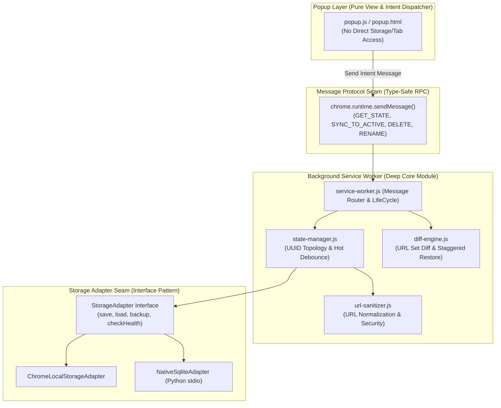

# Single Source of Truth (SOT) — Browser Tab Sync Extension (Microsoft Edge on Ubuntu Linux)

> **Version:** 2.3.0 (Recovery Checkpoints & Suspected Tab-Loss Protection)  
> **Target Platform:** Microsoft Edge on Ubuntu Linux OS (Primary) & Chromium Browsers (Manifest V3)  
> **Status:** Automated regression suite verified; live Edge restart smoke test pending  
> **Language:** Thai & Technical English Reference  

---

## 1. ภาพรวมและวัตถุประสงค์หลัก (Executive Summary & Core Objectives)

ระบบ **Browser Tab Sync Extension** ออกแบบมาสำหรับ **Microsoft Edge บน Ubuntu Linux OS** เพื่อตรวจจับ ซิงค์ และสำรองข้อมูลแท็บ (Browser Tabs) ที่เปิดอยู่ในแต่ละหน้าต่าง (Multi-Window Topology) แบบแยกอิสระ พร้อมระบบกู้คืนแท็บอัจฉริยะ (Smart Missing Tab Restore) ที่ประหยัดทรัพยากร 100%:

1. **Hot Active State (บันทึกเร็ว ป้องกันข้อมูลตกหล่น):**  
   - ตรวจจับ Event การเปลี่ยนแปลงของ Tab/Window แบบ Event-driven ด้วย Debounce สั้นมาก (300ms - 500ms)
   - **0ms Instant Flush:** เมื่อมีการปิดแท็บ (`onRemoved`) หรือปิดหน้าต่าง (`windows.onRemoved`) ระบบจะเขียนสถานะลง Storage ทันทีโดยไม่รอ Debounce เพื่อป้องกันช่องว่างข้อมูลสูญหาย (Zero Crash Gap)
2. **Persistent Window Identity (UUID-based Architecture):**  
   - กำหนด `windowUuid` ที่ extension สร้างเองและบันทึกถาวรให้แต่ละ logical window; browser `windowId` ใช้เฉพาะ session ปัจจุบันและเก็บ mapping ใน `chrome.storage.session` เพื่อให้รอดจาก service-worker restart
   - **Active Windows (Read-Only Mirror):** หน้าต่างที่เปิดใช้งานอยู่จริง จะแสดงผลแบบอ่านอย่างเดียว เพื่อป้องกันปัญหา Auto-Resync Loop
   - **Closed Windows (Editable Archive & Pinned Templates):** หน้าต่างที่ปิดไปแล้ว จะถูกย้ายไปเก็บเป็น Snapshot Archive ซึ่งผู้ใช้สามารถเลือก **ลบแท็บที่ไม่ต้องการ**, **เลือกแท็บเป็นกลุ่ม (Multi-Select)**, **ลบหน้าต่างที่ปิดไปแล้วทั้งชุด** หรือ **📌 ปักหมุดเป็น Window Template ที่มีโอกาสถูกลบเมื่อเกินเพดาน Archive** โดย Archive เก็บได้ไม่เกิน 5 หน้าต่าง รวมรายการที่ปักหมุด เรียงใหม่สุดก่อน และรวม snapshot ซ้ำที่มีชื่อ/ลำดับ URL/กลุ่ม/pin เหมือนกัน
   - **Inline Window Naming:** ผู้ใช้สามารถคลิกตั้งชื่อหรือแก้ไขชื่อหน้าต่าง (เช่น "งานโปรเจกต์ A", "อ่านข่าว") ได้โดยตรงจาก UI
3. **Restore Mutex Lock Guard & Staggered Creation:**
   - ล็อก restore ก่อนเริ่ม query/diff เพื่อไม่ให้คำสั่ง Sync ซ้อนเปิดแท็บชุดเดียวกัน และระงับ snapshot event ระหว่าง restore
   - **Staggered Restore:** เปิดแท็บทีละรายการโดยเว้น 200ms ต่อแท็บ เพื่อลด CPU burst ระหว่าง restore
4. **Selective "Sync to Active Window" Restore Engine:**  
   - ผู้ใช้สามารถเลือก Snapshot ของ `windowUuid` ที่เคยปิดไป แล้วกด **"Sync เข้าสู่หน้าต่างปัจจุบัน (Sync to this Window)"** (หรือเลือกเฉพาะบางแท็บที่ต้องการกู้คืน)
   - ระบบใช้ **Normalized URL Set Diff Engine** เปิดเฉพาะ URL ที่ยังไม่มีและเปิดได้ไม่เกินหนึ่งแท็บต่อ URL; ข้อมูลใน active state และ closed archive จะ dedupe URL ซ้ำด้วย
5. **Startup & Crash Reconciliation (ป้องกัน Ghost Active Windows):**  
   - จับคู่ snapshot ของ session ก่อนหน้ากับหน้าต่าง Edge ที่เปิดอยู่ด้วย URL overlap ก่อนสร้างหน้าต่างเพิ่ม และคง `windowUuid` เดิมไว้
   - `closedWindows` เป็นประวัติกู้คืนที่ผู้ใช้จัดการเอง ไม่ถูกนำมาเป็น input สำหรับ auto-restore; `previousSessionBackup` เก็บเฉพาะ active/session snapshot ไม่รวม archive เก่า
6. **Recovery Checkpoints & Suspected Tab-Loss Protection:**
   - Service worker สร้าง checkpoint จาก live windows ทุก 1 นาที และจับภาพทันทีหลัง navigation เสร็จหรือแท็บถูกปิด เก็บ session snapshots ที่ไม่ซ้ำกันล่าสุดไม่เกิน 5 ชุด แยกจาก closed-window archive
   - ระหว่าง startup reconciliation 10 วินาทีแรก แท็บ placeholder เช่น `edge://newtab` จะไม่เขียนทับ snapshot เว็บเดิม เพื่อป้องกัน Edge คืนค่า session ช้ากว่า extension
   - Fingerprint ของ checkpoint รวมลำดับแท็บด้วย ดังนั้นการจัดเรียงแท็บจะสร้าง snapshot ใหม่ได้
   - Query ที่ไม่ครบ, ไม่มี live window, หรือไม่มีแท็บเว็บที่บันทึกได้ จะไม่เขียน checkpoint ว่างทับข้อมูลกู้คืน
   - หาก URL จาก checkpoint ล่าสุดหายไปอย่างน้อย 5 URL หรือหายไปอย่างน้อย 50% ระบบจะแจ้งว่าอาจมี tab loss และหยุดหมุนเวียน checkpoint จนกว่าผู้ใช้จะกู้คืนหรือยืนยันว่าปิดเอง
   - การกู้คืนเป็นแบบ additive: เปิดเฉพาะ URL ที่ยังไม่มีในหน้าต่างปัจจุบัน รักษา tab group และไม่ปิดหรือแทนที่แท็บที่ยังเปิดอยู่
   - Browser API ระบุไม่ได้แน่ชัดว่าใครเป็นผู้ปิดแท็บ การแจ้งเตือนจึงเป็น heuristic และผู้ใช้ยกเลิกได้
7. **Direct Drive Storage via SQLite WAL Mode on Ubuntu Linux:**  
   - บันทึกลง **SQLite Database** (`~/.local/share/sync-tab/tabs.sqlite`) ในโหมด `WAL (Write-Ahead Logging)` ผ่าน **Native Messaging Host** บน Ubuntu Linux
   - **Deterministic Extension Key:** ระบุค่า Public Key ใน `manifest.json` เพื่อให้ Extension ID คงที่ตลอดไป ป้องกันปัญหา Native Messaging หลุดการเชื่อมต่อเมื่อโหลด Unpacked Extension บน Linux
   - **In-Extension Interactive Setup Guide:** หน้า Extension Popup มีแท็บ/แบนเนอร์แสดงสถานะการเชื่อมต่อ และคู่มือแนะนำคำสั่ง 1 บรรทัดพร้อมปุ่ม Copy ให้ผู้ใช้รันติดตั้งได้ง่ายที่สุด พร้อมปุ่มกดทดสอบการเชื่อมต่อแบบเรียลไทม์

---

## 2. การออกแบบสถาปัตยกรรมระดับโมดูล (Deep Module Architecture & Seams)

การออกแบบใช้หลักการ **Deep Modules (Interface แคบและเรียบง่าย แต่ซ่อนความซับซ้อนภายในไว้อย่างมิดชิด)** และ **Unidirectional State Flow**:



### 2.1. สัญญาการสื่อสารระหว่าง Popup และ Service Worker (Message Protocol):
Popup UI จะ **ไม่แตะ Storage หรือ Browser Tabs โดยตรง** แต่จะสื่อสารผ่าน Typed Message Protocol เท่านั้น:

```typescript
export type ExtensionMessage =
  | { type: "GET_STATE" }
  | { type: "SYNC_WINDOW_TO_ACTIVE"; payload: { targetUuid: string; activeWindowId: number; selectedIndices?: number[] } }
  | { type: "DELETE_CLOSED_WINDOW"; payload: { windowUuid: string } }
  | { type: "DELETE_CLOSED_TAB"; payload: { windowUuid: string; tabIndex: number } }
  | { type: "RENAME_WINDOW"; payload: { windowUuid: string; newName: string } }
  | { type: "TOGGLE_PIN_TEMPLATE"; payload: { windowUuid: string } }
  | { type: "TEST_NATIVE_CONNECTION" }
  | { type: "TRIGGER_MANUAL_BACKUP" }
  | { type: "RESTORE_RECOVERY_CHECKPOINT"; payload: { timestamp: number; activeWindowId: number } }
  | { type: "ACKNOWLEDGE_RECOVERY_ALERT" }
  | { type: "EXPORT_DATA"; payload: { format: "json" | "markdown" } }
  | { type: "IMPORT_DATA"; payload: { jsonContent: string } };
```

---

## 3. โครงสร้างไฟล์ในโปรเจกต์ (Codebase File Layout)

```
sync tab/
├── manifest.json                  # Manifest V3 Configuration (Deterministic Key, Permissions, Commands)
├── shared/
│   ├── constants.js               # Global Constants, Default Settings, 9-Color Enums, Timings
│   ├── types.js                   # JSDoc / TS Type Definitions for TabData, WindowData, Messages
│   └── messages.js                # Message Action Constants (GET_STATE, SYNC, DELETE, etc.)
├── background/
│   ├── service-worker.js          # Entry Point: Event Listeners & Message Routing
│   ├── recovery-scheduler.js      # One-minute alarm lifecycle and checkpoint scheduling
│   ├── state-manager.js           # Deep Module: UUID Topology, Hot Debouncer, 0ms Close Flush
│   ├── diff-engine.js             # Deep Module: URL Set Diff Matcher & Staggered Restore
│   ├── group-manager.js           # Deep Module: Scoped Tab Group Constructor & Color Sanitizer
│   ├── url-sanitizer.js           # Pure Function: Privileged URL Filter & Tracking Param Stripper
│   └── storage/
│       ├── storage-adapter.js     # Storage Adapter Interface Contract
│       ├── local-adapter.js       # chrome.storage.local Adapter
│       └── native-adapter.js      # Native Messaging SQLite Adapter (Python Stdio Bridge)
├── popup/
│   ├── popup.html                 # Semantic HTML5 Layout (Sticky Header, Accordion, Toast, Setup Modal)
│   ├── popup.css                  # Modern Glassmorphic Theme (GNOME Dark/Light Mode Adaptive)
│   └── popup.js                   # Pure View Controller: Render State & Dispatch Intent Messages
├── native-host/
│   ├── native_host.py             # Python 3 Stdio Binary Protocol + SQLite WAL DB Engine
│   ├── com.synctab.native.json    # Native Messaging Host Manifest
│   └── setup_native_host.sh       # 1-Click Ubuntu Linux Setup Script (chmod +x, symlink)
└── icons/
    ├── icon-16.png
    ├── icon-32.png
    ├── icon-48.png
    └── icon-128.png
```

---

## 4. โครงสร้างข้อมูล (Data Schemas)

```typescript
// 1. มาตรฐานสี Tab Group ตาม Chromium API
export type TabGroupColor = "grey" | "blue" | "red" | "yellow" | "green" | "pink" | "purple" | "cyan" | "orange";

// 2. ข้อมูลตำแหน่งหน้าต่าง
export interface WindowBounds {
  left?: number;
  top?: number;
  width?: number;
  height?: number;
  state?: "normal" | "minimized" | "maximized" | "fullscreen";
}

// 3. ข้อมูลกลุ่มแท็บ
export interface TabGroupData {
  title: string;
  color: TabGroupColor;
  collapsed: boolean;
}

// 4. ข้อมูลแท็บ
export interface TabData {
  url: string;              // Normalized Target URL
  title: string;            // Page Title (Max 500 chars for buffer safety)
  favIconUrl?: string;      // Favicon URL
  pinned: boolean;          // Pinned status
  index: number;            // Order in window
  group?: TabGroupData;     // Group metadata
}

// 5. ข้อมูลหน้าต่าง (ระบุตัวตนด้วย UUID)
export interface WindowData {
  windowUuid: string;       // Unique UUID v4
  customName?: string;      // เช่น "งานโปรเจกต์ A", "อ่านข่าว"
  isClosed: boolean;        // true = หน้าต่างปิดไปแล้ว (Editable Archive), false = เปิดอยู่จริง (Read-Only)
  isPinnedTemplate?: boolean; // true = ปักหมุดเป็น Template; ยังอยู่ภายใต้เพดาน Archive รวม 5 รายการ
  closedAt?: number;        // Timestamp ตอนปิดหน้าต่าง
  lastUpdated: number;      // Timestamp ล่าสุดที่มีการเปลี่ยนแปลง
  bounds?: WindowBounds;    // ขนาดและตำแหน่งบนหน้าจอ
  tabs: TabData[];
}

// 6. Schema รวมใน Storage
export interface SyncedStorageSchema {
  version: "2.3.0";
  
  // หน้าต่างที่กำลังเปิดใช้งานอยู่จริง (Read-Only ใน UI)
  activeWindows: Record<string, WindowData>; // Key: windowUuid

  // ประวัติหน้าต่างที่ปิดไปแล้ว (Editable Archive: ลบแท็บ/ลบหน้าต่าง/ปักหมุด Template ได้)
  closedWindows: Record<string, WindowData>; // Key: windowUuid

  // สำรองเซสชันล่าสุด 1 ชุด (Single Rolling Backup)
  previousSessionBackup?: {
    timestamp: number;
    triggerReason: "last_window_close" | "browser_shutdown" | "crash_recovery" | "manual_checkpoint";
    totalWindows: number;
    totalTabs: number;
    windows: WindowData[];
  };

  // Recent distinct safe snapshots, newest first, capped at five.
  recoveryCheckpoints: Array<{
    timestamp: number;
    lastVerifiedAt: number;
    totalWindows: number;
    totalTabs: number;
    fingerprint: string;
    windows: WindowData[];
  }>;

  // A suspected-loss notice freezes checkpoint rotation until restore or user acknowledgement.
  recoveryAlert: null | {
    detectedAt: number;
    lostTabs: number;
    previousTabCount: number;
    currentTabCount: number;
    checkpointTimestamp: number;
  };

  skipNextRecoveryLossCheck: boolean;

  // Recovery checkpoints and alert are retained in the chrome.storage.local mirror.
  // NativeAdapter merges them back when loading the current SQLite payload.

  // การตั้งค่า
  settings: {
    storageDriver: "auto" | "chrome_storage" | "sqlite_native"; // auto: fallback อัตโนมัติ
    sqliteDbPath: string;                                      // Default: ~/.local/share/sync-tab/tabs.sqlite
    lazyRestore: boolean;                                      // ใช้ discarded: true (Sleeping Tabs)
    autoCleanBlankNewTab: boolean;                             // ปิดแท็บว่างอัตโนมัติเมื่อ Restore เสร็จ
    maxClosedWindowsRetention: number;                         // ค่าเริ่มต้น: 5 หน้าต่าง รวม Pinned (กำหนดได้ 1–5)
    stripTrackingParams: boolean;                              // ตัด utm_*, fbclid ออกจาก URL
    blacklistDomains: string[];                                // โดเมนที่ไม่ต้องการบันทึก
  };
}
```

---

## 5. จุดเสี่ยงที่ได้รับการป้องกัน (Vulnerability & Architectural Safeguards)

| จุดเสี่ยง (Vulnerability / Edge Case) | วิธีการแก้ไขในสถาปัตยกรรม (Hardened Solution) |
|---|---|
| **1. UI Logic Leak (โค้ด Popup ซับซ้อนและเปราะบาง)** | **Unidirectional Message Passing:** ย้าย Logic ทางธุรกิจทั้งหมดไปไว้ที่ Service Worker; ตัว Popup ทำหน้าที่เป็น View Renderer และส่ง Message เท่านั้น |
| **2. Storage Tight Coupling (ผูกติด Storage engine)** | **Storage Adapter Pattern:** ซ่อนความแตกต่างระหว่าง Local Storage และ Native SQLite ไว้หลัง Interface เดียวกัน |
| **3. Restore Event Storm & Race Condition** | **Restore Mutex Lock Guard (`isRestoring`):** ล็อกก่อน query/diff, ระงับการบันทึกระหว่าง restore และรอ settle ก่อนเก็บ state ล่าสุด |
| **4. Native Messaging 1MB Payload Limit** | **Defensive Truncation:** ตัดความยาว Title ไม่เกิน 500 ตัวอักษร และตัด Base64 Favicon ทิ้ง เพื่อการันตี Payload < 1MB เสมอ |
| **5. Ghost Active Windows (หน้าต่างผีค้าง)** | **Startup Reconciler:** ตรวจสอบกับ `chrome.windows.getAll()` หากมี Window ค้างใน Storage จะย้ายไปเก็บที่ `closedWindows` ทันที |
| **6. Massive Tab Restore (50+ แท็บ)** | **Staggered Restore:** เปิดแท็บครั้งละหนึ่งแท็บ โดยเว้น 200ms ระหว่างแท็บ เพื่อลด CPU burst |
| **7. Service-worker restart identity loss** | **Session UUID Mapping:** rehydrate `windowId -> windowUuid` จาก `chrome.storage.session`; ถ้า mapping ไม่มี ให้จับคู่ active snapshot กับ live windows ด้วย URL overlap |
| **8. Stale last-known tabs after intentional emptying** | **Authoritative Empty Snapshot:** live window ที่เหลือแต่ internal/ignored tabs จะล้าง `lastKnownTabs`; fallback ใช้เฉพาะกรณี browser drain ตอนปิดหน้าต่าง |
| **9. Closed archive restored as previous session** | **Separate Session Backup:** ปิด archive history ไม่ให้ไหลเข้า `previousSessionBackup` หรือ startup auto-restore |
| **10. Browser drops many tabs during a live session** | **One-minute recovery checkpoints:** เก็บ snapshot ล่าสุดสูงสุด 5 ชุด; ตรวจพบ URL หายอย่างน้อย 5 URL หรืออย่างน้อย 50%; แจ้งเตือนและ freeze checkpoint rotation จน restore หรือ acknowledge |
| **11. Alarm/query returns an empty or partial state** | **Safe capture gate:** ไม่สร้าง checkpoint เมื่อ query ล้มเหลว, ไม่มี live windows, หรือไม่มี eligible web tabs; checkpoint ก่อนหน้าคงอยู่ |
| **12. Empty browser query erases active snapshots** | `syncActiveWindows` ไม่ยอมแทนที่ active state ด้วย sample ที่ไม่มี regular windows; cleanup ที่ตั้งใจทำผ่าน `windows.onRemoved` และ startup reconciliation เท่านั้น |
| **13. Duplicate event storms and storage churn** | Browser sync/checkpoint requests are coalesced; unchanged window snapshots do not write storage, and unchanged SQLite payloads skip full-table rewrites |
| **14. Native/local storage divergence** | `NativeAdapter` honors explicit `chrome_storage`, merges local-only settings/checkpoint metadata, and seeds an empty SQLite database from a populated local mirror |
| **15. Native SQLite load failure** | Native host returns failure instead of a successful empty schema when DB loading fails, so the extension can retain its local mirror |
| **16. Imported full backup omits active windows** | Imported active/session snapshots become recoverable archive entries; they never overwrite the live browser mirror. Imported settings are normalized and unsafe URL schemes are excluded |
| **17. Transient storage initialization failure poisons worker lifetime** | Reset the cached initialization promise after rejection so later events can retry instead of keeping a permanently rejected promise |
| **18. Native/local storage diverges after a failed SQLite write** | Merge active and archived windows from both sources by UUID and revision; prefer the newer snapshot, preserve local-only metadata, and repair stale SQLite state |
| **19. Oversized Native Messaging frame** | Native Host rejects inbound frames above 1 MiB before allocating their payload and bounds outbound frames with a structured failure response |
| **20. Import failure leaves partially mutated in-memory state** | Import has a 10 MiB limit and restores prior settings/archive/checkpoint/cache references if validation or persistence fails |
| **21. Out-of-order popup refreshes** | Ignore stale `GET_STATE` responses when a newer refresh request has already started; reject oversized import files before reading them |
| **22. Blacklist setting was inert** | Normalize domain/URL entries, match exact hosts and subdomains safely, filter excluded domains from active snapshots, and expose a one-domain-per-line settings field |
| **23. Intentional window close looks like mass tab loss** | When other regular windows remain, refresh the trusted checkpoint baseline while skipping only the loss heuristic for that explicit close; preserve the last checkpoint when the final window closes |
| **24. Manual backup aliases live objects** | Clone window/tab/group data by value when creating a manual backup so later edits cannot mutate the historical snapshot |
| **25. Blank or legacy `Untitled` tab title** | Derive a readable fallback from the HTTP(S) hostname and final URL path segment; migrate stored placeholders without overwriting meaningful titles, and retain a popup-side defensive fallback |

---

## 6. โครงสร้าง SQLite Native Drive Storage (Ubuntu Linux)

```sql
-- โครงสร้างตารางใน SQLite (~/.local/share/sync-tab/tabs.sqlite)
PRAGMA journal_mode = WAL;
PRAGMA user_version = 1;

CREATE TABLE IF NOT EXISTS windows (
    window_uuid TEXT PRIMARY KEY,
    custom_name TEXT,
    is_closed INTEGER DEFAULT 0,
    is_pinned_template INTEGER DEFAULT 0,
    closed_at INTEGER,
    last_updated INTEGER NOT NULL,
    bounds_json TEXT
);

CREATE TABLE IF NOT EXISTS tabs (
    id INTEGER PRIMARY KEY AUTOINCREMENT,
    window_uuid TEXT NOT NULL,
    url TEXT NOT NULL,
    title TEXT,
    fav_icon_url TEXT,
    pinned INTEGER DEFAULT 0,
    tab_index INTEGER NOT NULL,
    group_title TEXT,
    group_color TEXT,
    group_collapsed INTEGER DEFAULT 0,
    FOREIGN KEY (window_uuid) REFERENCES windows(window_uuid) ON DELETE CASCADE
);

CREATE TABLE IF NOT EXISTS rolling_backups (
    backup_id INTEGER PRIMARY KEY AUTOINCREMENT,
    timestamp INTEGER NOT NULL,
    trigger_reason TEXT NOT NULL,
    payload_json TEXT NOT NULL
);
```

---

## 7. คู่มือและหน้าต่างแนะนำการติดตั้ง Native SQLite ภายใน Extension (In-Extension Setup Guide)

```
┌─────────────────────────────────────────────────────────────┐
│ 🟢 SQLite Drive: Connected (~/.local/share/sync-tab/tabs.sqlite)│
└─────────────────────────────────────────────────────────────┘
  (กรณีเชื่อมต่อสำเร็จแล้ว จะแสดงสถานะสีเขียวพร้อม Path ไฟล์)

┌─────────────────────────────────────────────────────────────┐
│ 🟡 SQLite Native Storage ยังไม่ได้เชื่อมต่อ                │
│    บันทึกแท็บของคุณลงในฮาร์ดดิสก์ Ubuntu ถาวร ป้องกันข้อมูลสูญหาย │
│                                                             │
│ 1. เปิด Terminal บน Ubuntu (กด Ctrl + Alt + T)              │
│ 2. คัดลอกและรันคำสั่งนี้เพียงบรรทัดเดียว:                   │
│    ┌──────────────────────────────────────────────────────┐ │
│    │ cd ~/Documents/Src\ Code/sync\ tab/native-host && ./setup_native_host.sh │ [📋 Copy] │
│    └──────────────────────────────────────────────────────┘ │
│ 3. กดปุ่ม [🔄 ทดสอบการเชื่อมต่อ (Test Connection)]          │
└─────────────────────────────────────────────────────────────┘
```

---

## 8. แผนการพัฒนาและทดสอบ (Implementation Roadmap & QA Matrix)

### 8.1. ลำดับขั้นการพัฒนา (Development Milestones):
1. **Phase 1: Foundation & Contracts:** สร้าง `manifest.json`, `shared/constants.js`, `shared/messages.js`, `shared/types.js`
2. **Phase 2: Core Background Service Worker & Deep Modules:**
   - `state-manager.js` (Topology Tracking, Hot Debounce, 0ms Close Flush)
   - `url-sanitizer.js` (Pure Normalization & Privileged Sanitizer)
   - `group-manager.js` (Scoped Grouping & Color Sanitizer)
   - `service-worker.js` (Message Router & Lifecycle Listeners)
3. **Phase 3: Storage Layer (Storage Adapter Pattern):**
   - `storage/storage-adapter.js` (Interface Contract)
   - `storage/local-adapter.js` (`chrome.storage.local`)
   - `storage/native-adapter.js` (Native Messaging Bridge)
4. **Phase 4: Smart Diff & Restore Engine:**
   - `diff-engine.js` (Restore Mutex Guard, URL Set Diff, Staggered Restore, Sleeping Tab Creator)
5. **Phase 5: Ubuntu Linux Native SQLite Host:**
   - `native-host/native_host.py` (Python 3 Stdio Binary Protocol + SQLite WAL DB Engine)
   - `native-host/setup_native_host.sh` (1-Click Linux Setup Script)
6. **Phase 6: Modern Glassmorphic Popup UI:**
   - `popup/popup.html`, `popup/popup.css` (Dark/Light GNOME Theme), `popup/popup.js` (State Rendering & Message Dispatcher)

### 8.2. ตารางทดสอบความถูกต้อง (QA Verification Matrix):
| เคสทดสอบ (Test Scenario) | การกระทำ | ผลลัพธ์ที่ถูกต้อง (Expected Result) |
|---|---|---|
| **Test 1: Hot Sync & 0ms Close** | เปิด 5 แท็บ แล้วปิด 1 แท็บกะทันหัน | Storage อัปเดตทันทีแบบ 0ms ข้อมูลแท็บที่เหลือถูกต้องครบถ้วน |
| **Test 2: Multi-Window Isolation** | เปิด Window A (3 แท็บ) และ Window B (4 แท็บ) | Storage เก็บแยก 2 `windowUuid` ข้อมูลไม่ปนกัน |
| **Test 3: Closed Window Edit** | ปิด Window B แล้วเปิด Popup ลบ 1 แท็บออกจาก Closed Window B | แท็บถูกลบออกจาก Snapshot สำเร็จ และไม่เกิด Auto-Resync Loop |
| **Test 4: Sync to Current Window** | เลือก Closed Window B แล้วกด "Sync เข้าสู่หน้าต่างปัจจุบัน" | เปิดเฉพาะแท็บที่ยังไม่มีในหน้าต่างปัจจุบันเป็น Edge Sleeping Tabs |
| **Test 5: Browser Crash / Kill Process** | รันคำสั่ง `killall -9 msedge` แล้วเปิด Edge ใหม่ | Startup Reconciler จับคู่/กู้คืน session เดิม; snapshot ที่กู้คืนสำเร็จอยู่ใน active state ส่วนที่กู้คืนไม่ได้คงอยู่ใน archive |
| **Test 7: Edge-restored windows** | เปิด Edge ต่อจาก session ก่อนหน้าโดยมีหลาย window | UUID เดิมจับคู่กับ window ที่มี URL overlap มากสุด และไม่มี secondary window ซ้ำ |
| **Test 8: Closed archive isolation** | มี archive เก่าแล้วปิดหน้าต่างปัจจุบัน จากนั้นเปิด Edge | backup/auto-restore ใช้ snapshot ของ session ปัจจุบันเท่านั้น ไม่ restore archive เก่า |
| **Test 6: Native SQLite & Cache Wipe** | รัน Clear Browsing Cache ใน Edge | ไฟล์ `~/.local/share/sync-tab/tabs.sqlite` บน Ubuntu ยังคงอยู่ครบ 100% |
| **Test 9: Unexpected live tab loss** | บันทึก checkpoint 10 แท็บ แล้วจำลองให้เหลือ 3 แท็บ | แจ้ง suspected loss, คง checkpoint 10 แท็บไว้ และไม่หมุน checkpoint จน acknowledge |
| **Test 10: Additive checkpoint recovery** | กู้ checkpoint ที่มีทั้ง URL ซ้ำและ URL ที่หาย พร้อม tab group | เพิ่มเฉพาะ URL ที่หาย ไม่สร้าง URL ซ้ำ คืน group metadata และคงแท็บปัจจุบันไว้ |
| **Test 11: Checkpoint retention** | บันทึกสถานะที่เปลี่ยนต่อเนื่องเกิน 5 รอบ | เก็บ checkpoint ที่แตกต่างล่าสุดไม่เกิน 5 ชุด เรียงใหม่สุดก่อน |
